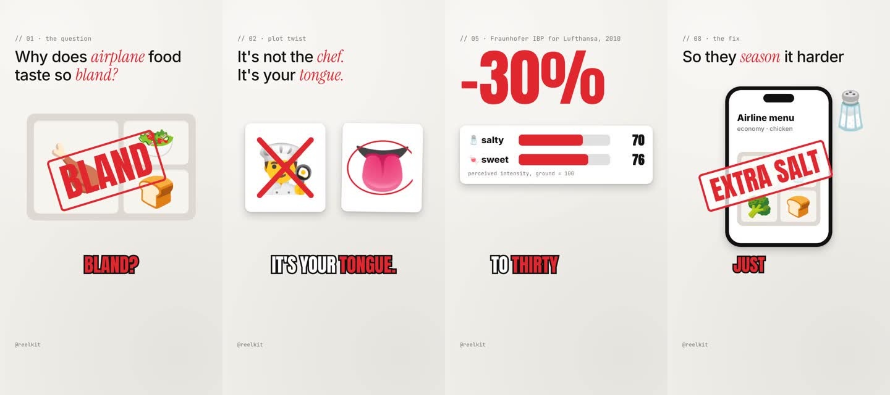

# reelkit

**Type one line. Get a finished, voiced, captioned, animated vertical reel.** Free and open source.



```
you:     make a reel about why airplane food tastes so bland
Claude:  writes the script → records the voiceover → animates every scene
         → times captions to every word → checks its own frames → renders out/airplane-food.mp4
you:     the hook feels slow
Claude:  tightens scene 1, re-voices only that scene, re-checks, re-renders
```

reelkit is a [Claude Code](https://claude.com/claude-code) skill plus a small rendering engine. There's no cloud service, no subscription and no watermark. You bring Claude Code and (optionally) a voice API key; everything else runs on your machine.

## Why this exists

"AI-animated reel" workflows are being sold behind a "comment SKILL and I'll DM it to you" wall. Under the hood they're a folder of instructions plus a few open tools: Node, a headless browser, ffmpeg and a TTS voice. This repo is that, built from scratch in the open, so anyone can use it, read it and improve it.

## Setup (about 5 minutes)

1. **Install Claude Code** (desktop app or CLI): https://claude.com/claude-code
2. **Get this folder:**
   ```bash
   git clone https://github.com/nathanaelhub/reelkit.git
   cd reelkit
   ```
   (or download the ZIP and unzip it anywhere, e.g. `~/Desktop/reelkit`)
3. **Open the folder in Claude Code.** In the desktop app: New session → **Local** → select the `reelkit` folder. In a terminal: `cd reelkit && claude`.
4. **Ask Claude to check your setup:**
   > check my setup

   Claude runs `npm run doctor -- --fix`, which installs the npm packages, a headless Chromium (for animating) and a bundled ffmpeg (for rendering) if you don't have one.
5. **Voice.** Nothing to do: `doctor -- --fix` downloads **Kokoro**, a free voice that runs on your machine (open weights, Apache-2.0, fine for reels you publish or sell). Every voice except ElevenLabs gets its word timing from **Whisper**, also local, so captions and word-synced animation land on the exact word. A key is an optional upgrade: copy `.env.example` to `.env` and add one.

   | Voice | Cost | Quality | Word timing | Publish / sell? |
   |---|---|---|---|---|
   | Kokoro (default, local) | free | natural | Whisper-aligned | yes |
   | `ELEVENLABS_API_KEY` | free tier, then paid | most expressive | from the API | yes (see their terms) |
   | `OPENAI_API_KEY` | pay per use | good | Whisper-aligned | yes (see their terms) |
   | [Piper](https://github.com/OHF-Voice/piper1-gpl) (`PIPER_MODEL`) | free, offline | decent | Whisper-aligned | only voices whose licence allows it; Lessac-based voices don't |
   | macOS `say` | free, built in | robotic | Whisper-aligned | no: Apple licenses it for personal, non-commercial use |
   | none | free | silent draft | estimated | n/a |

   reelkit picks the best one available automatically.

## Make a reel

In Claude Code, just say what you want:

> make a reel about why airplane food tastes so bland

> make a 30 second reel explaining how compound interest works, dark theme

> make a reel from this blog post: …

Then give notes like you would to a human editor: *"the hook is weak"*, *"scene 4 drags"*, *"make the stamp bigger"*, *"use a deeper voice"*. Claude edits only what's needed and re-renders.

Your video lands in `out/<name>.mp4`.

## Give it taste

Reels look generic without a reference. Give reelkit 3 to 5 videos whose look you like:

> make a taste called my-brand from these: https://… https://… ~/Downloads/ad.mp4

`npm run ref` downloads them (yt-dlp), measures how often they cut, how much moves, how loud they are and their colours, and makes contact sheets. Claude writes notes on captions, type, colour and motion into `taste/my-brand/taste.md`. Reels with `"taste": "my-brand"` are planned from those notes, and `npm run check` compares each reel's pacing and frames with the references before rendering. Reference videos stay local (gitignored). See [taste/README.md](taste/README.md).

## Design rules, enforced

- All motion runs on closed-form spring physics (`spring`, `spring-snappy`, `spring-bouncy`, or `spring:k,c,m`).
- `npm run check` fails on CSS transitions or animations and on all-caps centred text over a colour gradient: the two most generic looks in AI video.

## Music and sound, written in code

Each reel has a `score.js` next to its `reel.html`: a backing track and sound effects written with [Tone.js](https://tonejs.github.io), timed to the same word timestamps the animation uses. No music licence, no stock library.

```js
export default function ({ bed, sfx }) {
  bed({ mood: 'upbeat', key: 'E' });   // warm · upbeat · tense · lofi · cinematic
  sfx.hit('@bland');                   // a thump the instant the narrator says "bland"
  sfx.scenes('whoosh');                // a whoosh into every scene
}
```

It renders offline in headless Chromium to `score.wav`, the same way every time, and the final mix ducks it under the voice. Prefer your own track? Drop it in as `music.mp3`.

## Formats and loudness

`"format"` in script.json picks 9:16 (default), 16:9 or 1:1; the check and render follow it. Every render ends with a two-pass loudness pass to `"loudness"` (default -14 LUFS, true peak -1.5 dB), so voice, music and silences come out at one consistent level.

## How it works

```
script.json ──voice──▶ voice.mp3 + timeline.json (every word's timestamp)
                                   │
reel.html (scenes + data-anim) ────┤
                                   ▼
            headless Chromium: seek(t) → screenshot, for every frame
                                   ▼
                    ffmpeg: frames + voice (+ music) → MP4
```

- **`engine/kit.js`**: a tiny deterministic animation runtime. Every frame is a pure function of time, so rendering is exact and repeatable. Motion is declared in HTML: `data-anim="stamp" data-at="@bland"` slams a stamp onto the screen the instant the narrator says "bland".
- **`engine/kit.css`**: the visual vocabulary: paper/ink/pop/cork themes, headlines with accent words, condensed display type, cards, stamps, chips, phone and app-window mockups, word-by-word captions.
- **`scripts/voice.mjs`**: one clip per scene (cached, so edits only re-voice what changed), word timestamps, loudness-normalised voiceover.
- **`scripts/check.mjs`**: the self-check. Lints layout (text off-screen, under the app UI, overflowing, overlapping other text, colliding with captions, references to words that aren't spoken), finds frozen stretches where nothing moves, and writes contact sheets that Claude looks at before rendering.
- **`scripts/render.mjs`**: parallel frame capture → H.264 MP4, with optional background music.
- **`.claude/skills/make-reel/`**: the instructions Claude follows (`SKILL.md`) and its guides for scripting, scene building, style and handling feedback.

## Commands (if you want to drive it yourself)

```bash
npm run doctor [-- --fix]          # check / install everything
npm run new -- my-reel "Title"     # scaffold reels/my-reel/
npm run voice -- my-reel           # voiceover + timeline.json
npm run score -- my-reel           # score.js → score.wav (render does this for you)
npm run ref -- my-brand <links>    # add reference videos to a taste, measure them
npm run clip -- my-reel src.mp4 3 7 # trim footage into a reel for <video data-clip>
npm run check -- my-reel           # lint + design rules + motion + taste check, contact sheets in out/
npm run preview -- my-reel         # watch in your browser with audio (space, ←/→)
npm run render -- my-reel          # out/my-reel.mp4   (--draft for fast half-res, --from/--to for a section)
```

## Example

`reels/airplane-food/` is a complete 46-second reel: 9 scenes, word-synced stamps, counters, drawn SVG, shrinking bars driven by a custom hook, and five kinds of transitions. Read its `reel.html` to see everything the kit can do.

## Contributing

Ideas that would make this better: more scene recipes and themes, a host-character template with mouth shapes, Whisper-based word alignment for the non-ElevenLabs voices, B-roll image search. PRs welcome.

## License

MIT. Use it, fork it, sell the reels you make with it.
