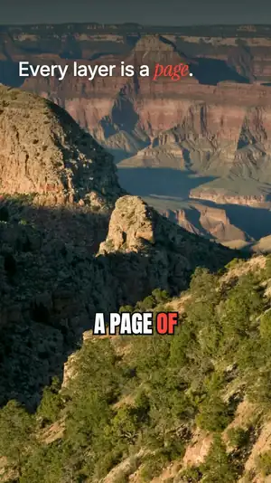

# reelkit

**Type one line. Get a finished vertical video: written, voiced, scored, animated, captioned and checked.**
Free, open source, and it runs on your own computer: no subscription, no watermark, no API key required.

<table>
<tr>
<td width="50%" align="center"><a href="https://github.com/nathanaelhub/reelkit/releases/download/v0.2.0/grand-canyon.mp4"></a><br><b>The canyon is younger than its rocks</b><br><sub>public-domain photos with 3D camera moves · film-burn, ink and whip transitions · cinematic score · British narrator<br><a href="https://github.com/nathanaelhub/reelkit/releases/download/v0.2.0/grand-canyon.mp4">▶ watch with sound</a> · <a href="reels/grand-canyon">source</a></sub></td>
<td width="50%" align="center"><a href="https://github.com/nathanaelhub/reelkit/releases/download/v0.2.0/airplane-food.mp4"></a><br><b>Why airplane food tastes so bland</b><br><sub>animated editorial explainer · word-synced stamps, counters and charts · upbeat score<br><a href="https://github.com/nathanaelhub/reelkit/releases/download/v0.2.0/airplane-food.mp4">▶ watch with sound</a> · <a href="reels/airplane-food">source</a></sub></td>
</tr>
</table>

<sub>Both made with the free defaults: every voice, note, camera move and frame above came from the open tools listed below, on a laptop.</sub>

```
you:     make a reel about why the Grand Canyon is younger than its rocks, use these photos
agent:   writes the script → voices it → scores it → animates every scene in sync with the words
         → checks its own frames → renders out/grand-canyon.mp4
you:     the hook is slow and the music is too loud
agent:   tightens scene 1, re-voices only that scene, lowers the bed, re-checks, re-renders
```

## Why this exists

"AI reel" tools are usually one closed service that does everything its own way. But a good short video is a stack of crafts: writing, voice, timing, motion, music, sound, transitions, colour, loudness. Each one already has an excellent open-source tool. reelkit is the glue: a coding agent directs, and every craft is handled by a tool you can read, swap or improve.

| Craft | Tool | Licence | What it does here |
|---|---|---|---|
| Direction | [Claude Code](https://claude.com/claude-code) (or any coding agent, see below) | n/a | writes the script, builds the scenes, looks at its own frames, takes your notes |
| Voice | [Kokoro-82M](https://github.com/hexgrad/kokoro) via [sherpa-onnx](https://github.com/k2-fsa/sherpa-onnx) | Apache-2.0 | a natural narrator, 28 English voices, on your CPU |
| Word timing | [Whisper](https://github.com/openai/whisper) via [transformers.js](https://github.com/huggingface/transformers.js) | MIT / Apache-2.0 | hears the voiceover so captions and animation land on the exact word |
| Picture | [Chromium](https://www.chromium.org) via [Playwright](https://playwright.dev) | BSD / Apache-2.0 | every scene is a web page, rendered frame by frame |
| Motion | `engine/kit.js` (this repo) | MIT | spring physics, word-synced entrances, counters, drawn SVG |
| Photos in 3D | [Depth Anything V2 Small](https://github.com/DepthAnything/Depth-Anything-V2) | Apache-2.0 | per-pixel depth, so a still photo gets a real camera move |
| Transitions | [gl-transitions](https://github.com/gl-transitions/gl-transitions) | MIT / BSD | 214 GPU shader transitions between scenes |
| Music & sound | [Tone.js](https://tonejs.github.io) | MIT | an original score and sound effects, written in code, timed to the words |
| Encode & mix | [FFmpeg](https://ffmpeg.org) | LGPL/GPL | H.264, ducking under the voice, two-pass loudness to −14 LUFS |
| References | [yt-dlp](https://github.com/yt-dlp/yt-dlp) | Unlicense | downloads videos you like so reelkit can measure their pacing and colour |

Every piece is optional or swappable: bring an ElevenLabs key for a different voice, your own `music.mp3`, your own footage.

## Setup (about 5 minutes)

1. **Install [Node.js](https://nodejs.org) 20+** and **[Claude Code](https://claude.com/claude-code)** (desktop app or CLI).
2. **Get this folder:**
   ```bash
   git clone https://github.com/nathanaelhub/reelkit.git
   cd reelkit
   ```
   (or download the ZIP and unzip it anywhere)
3. **Open the folder in Claude Code** (desktop: New session → Local → the `reelkit` folder; terminal: `cd reelkit && claude`) and say:
   > check my setup

   That runs `npm run doctor -- --fix`, which installs the packages, a headless Chromium, a bundled FFmpeg and the Kokoro voice (~130 MB). The Whisper and depth models (~80 MB and ~100 MB) download the first time they're needed. Everything is stored inside the folder.

That's it. No account, no key.

## Make a reel

Say what you want, in plain words:

> make a reel about why airplane food tastes so bland

> make a 30 second reel explaining compound interest, dark theme, calm music

> make a reel from these photos of my trip: ~/Pictures/lisbon/*.jpg

> make a reel from this blog post: …

Then give notes like you would to a human editor: *"the hook is weak"*, *"scene 4 drags"*, *"make the stamp bigger"*, *"use a British voice"*, *"less music"*. The agent edits only what's needed and re-renders. Your video lands in `out/<name>.mp4`.

## What it can do

**Voice, timed to the word.** Kokoro runs locally and is fine for reels you publish or sell. It speaks numbers, money and years ("$1,200", "1776", "9:16") and handles compound words, plurals and possessives; any name it still can't say goes into a pronunciation map as a respelling or phonemes. Whisper then times every word for every voice, so a stamp can slam down the instant the narrator says "bland".

**Photos that move in 3D.** A still photo gets a camera move through its depth map: push, pull, pan, rise, orbit, float or vertigo. Near things move more than far things, so it feels filmed instead of slid.
```html
<canvas class="abs" data-depth="assets/street.jpg" data-move="push" style="left:0;top:0;width:1080px;height:1920px"></canvas>
```

**214 shader transitions.** Ink bleeding through paper, film burns, whip pans, page curls, glitches. Render captures the two scenes separately, blends them on the GPU and lays the captions back on top, so they never smear.
```html
<section class="scene" data-scene="reveal" data-transition="gl:InkBleed">
```

**Music and sound, written in code.** Each reel has a `score.js`: a backing track in one of five moods and sound effects that land on spoken words. No music licence, no stock library, and it's ducked under the voice automatically. Prefer your own track? Drop in `music.mp3`.
```js
export default function ({ bed, sfx }) {
  bed({ mood: 'cinematic', key: 'D' });   // warm · upbeat · tense · lofi · cinematic
  sfx.hit('@340');                        // a thump when the narrator says "340"
  sfx.scenes('whoosh');                   // a whoosh into every scene
}
```

**Motion with rules.** Every entrance runs on spring physics, everything is a pure function of time (so renders are exact and repeatable), and `npm run check` fails on CSS animations and on all-caps centred text over a gradient: the two most generic looks in AI video.

**It checks its own work.** Before rendering, the check lints every scene (text off-screen or under the app's buttons, overlaps, captions covering content, frozen stretches) and writes contact sheets that the agent opens and looks at.

**Taste from references.** Give it 3 to 5 videos you like and it measures their cut rhythm, motion, loudness and colours, writes notes on their style, and compares your reel against them. See [taste/README.md](taste/README.md).

**Your footage.** Trim clips with `npm run clip` and place them with `<video data-clip>`; every rendered frame shows the exact source frame.

**Formats.** 9:16 (default), 16:9 or 1:1, and every render ends at a consistent −14 LUFS.

## Voices and licences

| Voice | Cost | Quality | Publish or sell? |
|---|---|---|---|
| Kokoro (default, local) | free | natural | yes (Apache-2.0) |
| `ELEVENLABS_API_KEY` in `.env` | free tier, then paid | most expressive | yes, under their terms |
| `OPENAI_API_KEY` in `.env` | pay per use | good | yes, under their terms |
| [Piper](https://github.com/OHF-Voice/piper1-gpl) (`PIPER_MODEL`) | free, offline | decent | only voices whose licence allows it; Lessac-based voices don't |
| macOS `say` | free, built in | robotic | no: Apple licenses it for personal, non-commercial use |

reelkit picks the best one available. Every voice except ElevenLabs gets Whisper word timing.

## How it works

```
script.json ──voice (Kokoro)──▶ voice.mp3 ──Whisper──▶ timeline.json (every word's time)
                                                             │
score.js ──Tone.js, offline──▶ score.wav                     │
photos ──Depth Anything──▶ depth maps                        │
reel.html (scenes + data-anim) ─────────────────────────────┤
                                                             ▼
                 headless Chromium: seek(t) → screenshot, every frame
                 (gl: transitions: two scenes + overlay → WebGL blend)
                                                             ▼
             FFmpeg: frames + voice + score (ducked) → loudness pass → MP4
```

- `engine/kit.js`, `engine/kit.css`: the motion runtime and visual vocabulary (themes, headlines, cards, stamps, chips, phone and window mockups, word-by-word captions, depth photos).
- `engine/score-kit.js`: moods, instruments and sound effects for score.js.
- `scripts/`: `voice`, `score`, `depth`, `check`, `render`, `preview`, `ref`, `clip`, `doctor`.
- `.claude/skills/make-reel/`: the instructions the agent follows, with guides for scripting, scenes, style and feedback.

## Commands (if you want to drive it yourself)

```bash
npm run doctor [-- --fix]           # check / install everything
npm run new -- my-reel "Title"      # scaffold reels/my-reel/
npm run voice -- my-reel            # voiceover + timeline.json
npm run score -- my-reel            # score.js → score.wav (render does this for you)
npm run depth -- my-reel            # depth maps for data-depth photos (check/render do this for you)
npm run check -- my-reel            # lint + design rules + motion + taste check, contact sheets in out/
npm run preview -- my-reel          # watch in your browser with audio (space, ←/→)
npm run render -- my-reel           # out/my-reel.mp4 (--draft for fast half-res, --from/--to for a section)
npm run ref -- my-brand <links>     # add reference videos to a taste, measure them
npm run clip -- my-reel src.mp4 3 7 # trim footage into a reel for <video data-clip>
npm test                            # the self-tests CI runs
```

## Other coding agents

The workflow lives in plain Markdown (`.claude/skills/make-reel/`), and [AGENTS.md](AGENTS.md) points Codex, Cursor, Gemini CLI and other agents at it. Claude Code is what it's tested with; other agents work as well as they follow long instructions and look at images.

## Examples

- [`reels/grand-canyon/`](reels/grand-canyon): a 33-second photo story. Six public-domain NPS photos with depth moves, five shader transitions, counters on spoken numbers, a cinematic score with hits on the numbers.
- [`reels/airplane-food/`](reels/airplane-food): a 37-second animated explainer. Nine scenes, word-synced stamps, counters, drawn SVG, bars driven by a custom hook, five kinds of transitions.

Read their `reel.html` and `score.js` to see everything the kit can do.

## Roadmap

- [x] Free local voice with exact word timing
- [x] Scores and sound effects in code, ducked under the voice
- [x] Photos with 3D camera moves
- [x] Shader transitions
- [ ] Style packs: named looks (engraving, risograph, blueprint, documentary…) with a rulebook and a demo each
- [ ] Raw footage in: scene detection, silence trimming, auto-reframing 16:9 → 9:16 around faces
- [ ] An MCP server, so any agent or app can call voice / check / render as tools
- [ ] A local studio page: timeline with word markers, notes box, render queue

Ideas and PRs welcome: see [CONTRIBUTING.md](CONTRIBUTING.md).

## Credits and licences

reelkit's own code is MIT. It installs, and does not bundle, the tools in the table above; each keeps its own licence. Model weights used by default: Kokoro-82M (Apache-2.0), Whisper base (MIT), Depth Anything V2 Small (Apache-2.0). The larger Depth Anything V2 models are non-commercial, so reelkit doesn't use them. Grand Canyon photos: U.S. National Park Service, public domain.

## License

MIT. Use it, fork it, sell the reels you make with it.
