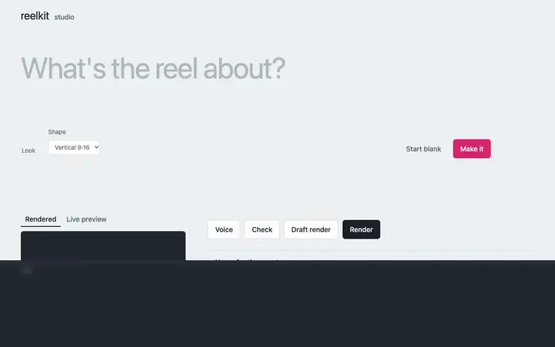
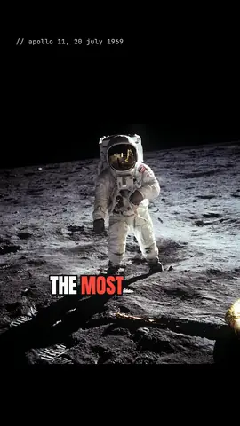
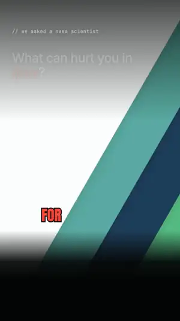
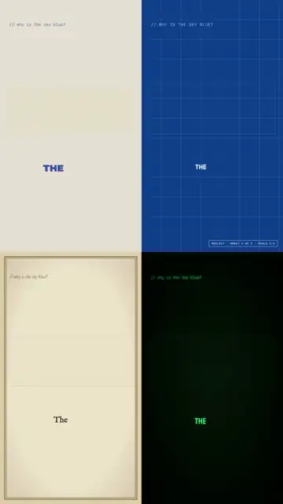
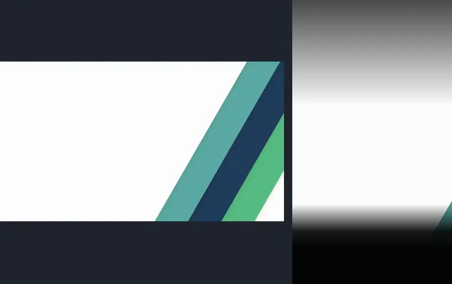

# reelkit

**Type one line. Get a finished vertical video: written, voiced, scored, animated, captioned and checked.**
Free, open source, and it runs on your own computer: no subscription, no watermark, no API key required.

<a href="https://github.com/nathanaelhub/reelkit/releases/download/v0.7.0/studio-demo.mp4"></a>

<sub>A real run in reelkit studio (`npm start`): one line typed, Risograph picked, **Make it** pressed. The agent took 8 minutes, sped up 40× here, and the log is blurred.</sub>

<table>
<tr>
<td width="33%" align="center" valign="top"><a href="https://github.com/nathanaelhub/reelkit/releases/download/v0.7.0/octopuses-have-three-hearts.mp4"></a><br><b>Typed: “why octopuses have three hearts”</b><br><sub>one line into the studio, blueprint look, one press of <b>Make it</b>: the agent wrote, drew, checked and rendered it unattended (re-voiced with Kokoro afterwards)<br><a href="https://github.com/nathanaelhub/reelkit/releases/download/v0.7.0/octopuses-have-three-hearts.mp4">▶ watch with sound</a> · <a href="reels/octopuses-have-three-hearts">source</a></sub></td>
<td width="33%" align="center" valign="top"><a href="https://github.com/nathanaelhub/reelkit/releases/download/v0.7.0/moon-photo.mp4"></a><br><b>The photographer in the visor</b><br><sub>one public-domain Apollo 11 photo · words set <i>behind</i> Aldrin with cut-outs · Armstrong found in the visor<br><a href="https://github.com/nathanaelhub/reelkit/releases/download/v0.7.0/moon-photo.mp4">▶ watch with sound</a> · <a href="reels/moon-photo">source</a></sub></td>
<td width="33%" align="center" valign="top"><a href="https://github.com/nathanaelhub/reelkit/releases/download/v0.3.0/space-dangers.mp4"></a><br><b>What can hurt you in space</b><br><sub>a 16:9 NASA interview cut to its best lines, pauses removed, reframed to 9:16 around her face · captions on her own words<br><a href="https://github.com/nathanaelhub/reelkit/releases/download/v0.3.0/space-dangers.mp4">▶ watch with sound</a> · <a href="reels/space-dangers">source</a></sub></td>
</tr>
<tr>
<td width="33%" align="center" valign="top"><a href="https://github.com/nathanaelhub/reelkit/releases/download/v0.2.0/grand-canyon.mp4"></a><br><b>The canyon is younger than its rocks</b><br><sub>six public-domain photos with 3D camera moves · film-burn, ink and whip transitions · cinematic score<br><a href="https://github.com/nathanaelhub/reelkit/releases/download/v0.2.0/grand-canyon.mp4">▶ watch with sound</a> · <a href="reels/grand-canyon">source</a></sub></td>
<td width="33%" align="center" valign="top"><a href="https://github.com/nathanaelhub/reelkit/releases/download/v0.2.0/airplane-food.mp4"></a><br><b>Why airplane food tastes so bland</b><br><sub>animated editorial explainer · stamps, counters and charts that land on the spoken word · upbeat score<br><a href="https://github.com/nathanaelhub/reelkit/releases/download/v0.2.0/airplane-food.mp4">▶ watch with sound</a> · <a href="reels/airplane-food">source</a></sub></td>
<td width="33%" align="center" valign="top"><a href="https://github.com/nathanaelhub/reelkit/releases/download/v0.4.0/sky-blue-styles.mp4"></a><br><b>One script, four looks</b><br><sub>the same reel rendered as risograph, blueprint, copperplate engraving and terminal, by changing one word<br><a href="https://github.com/nathanaelhub/reelkit/releases/download/v0.4.0/sky-blue-styles.mp4">▶ watch with sound</a> · <a href="reels/sky-blue">source</a> · <a href="styles">the packs</a></sub></td>
</tr>
</table>

<sub>All made on a laptop with the free defaults: every voice, note, camera move, cut, crop and caption above came from the open tools listed below. The previews are 7-second loops; ▶ plays the full reel with sound.</sub>

```
you:     make a reel about why the Grand Canyon is younger than its rocks, use these photos
agent:   writes the script → voices it → scores it → animates every scene in sync with the words
         → checks its own frames → renders out/grand-canyon.mp4
you:     the hook is slow and the music is too loud
agent:   tightens scene 1, re-voices only that scene, lowers the bed, re-checks, re-renders
```

## Why this exists

"AI reel" tools are usually one closed service that does everything its own way. But a good short video is a stack of crafts: writing, voice, timing, motion, music, sound, transitions, colour, loudness. Each one already has an excellent open-source tool. reelkit is the glue: a coding agent directs, and every craft is handled by a tool you can read, swap or improve.

| Craft | Tool | Licence | What it does here |
|---|---|---|---|
| Direction | [Claude Code](https://claude.com/claude-code) (or any coding agent, see below) | n/a | writes the script, builds the scenes, looks at its own frames, takes your notes |
| Voice | [Kokoro-82M](https://github.com/hexgrad/kokoro) via [sherpa-onnx](https://github.com/k2-fsa/sherpa-onnx); [Chatterbox](https://github.com/resemble-ai/chatterbox) for your own voice | Apache-2.0 · MIT | a natural narrator, 28 English voices, on your CPU; or clone your voice from a short sample |
| Word timing | [Whisper](https://github.com/openai/whisper) via [transformers.js](https://github.com/huggingface/transformers.js) | MIT / Apache-2.0 | hears the voiceover so captions and animation land on the exact word |
| Picture | [Chromium](https://www.chromium.org) via [Playwright](https://playwright.dev) | BSD / Apache-2.0 | every scene is a web page, rendered frame by frame |
| Motion | `engine/kit.js` (this repo) | MIT | spring physics, word-synced entrances, counters, drawn SVG |
| Cut-outs | [BiRefNet lite](https://github.com/ZhengPeng7/BiRefNet) | MIT | finds a photo's subject, so words can sit behind it |
| Photos in 3D | [Depth Anything V2 Small](https://github.com/DepthAnything/Depth-Anything-V2) | Apache-2.0 | per-pixel depth, so a still photo gets a real camera move |
| Transitions | [gl-transitions](https://github.com/gl-transitions/gl-transitions) | MIT / BSD | 214 GPU shader transitions between scenes |
| Music & sound | [Tone.js](https://tonejs.github.io) | MIT | an original score and sound effects, written in code, timed to the words |
| Encode & mix | [FFmpeg](https://ffmpeg.org) | LGPL/GPL | H.264, ducking under the voice, two-pass loudness to −14 LUFS |
| Your footage | FFmpeg scene + silence detection, Whisper, [MediaPipe](https://github.com/google-ai-edge/mediapipe) BlazeFace | LGPL/GPL · MIT · Apache-2.0 | finds the shots and every spoken word in a video, cuts the pauses out of a talk, and keeps the speaker's face in a vertical crop |
| References | [yt-dlp](https://github.com/yt-dlp/yt-dlp) | Unlicense | downloads videos you like so reelkit can measure their pacing and colour |

Every piece is optional or swappable: bring an ElevenLabs key for a different voice, your own `music.mp3`, your own footage.

## Setup (about 5 minutes)

1. **Install [Node.js](https://nodejs.org) 20+** and **[Claude Code](https://claude.com/claude-code)** (desktop app or CLI).
2. **Get this folder:**
   ```bash
   git clone https://github.com/nathanaelhub/reelkit.git
   cd reelkit
   ```
   (or download the ZIP and unzip it anywhere)
3. **Open the folder in Claude Code** (desktop: New session → Local → the `reelkit` folder; terminal: `cd reelkit && claude`) and say:
   > check my setup

   That runs `npm run doctor -- --fix`, which installs the packages, a headless Chromium, a bundled FFmpeg and the Kokoro voice (~130 MB). The Whisper and depth models (~80 MB and ~100 MB) download the first time they're needed. Everything is stored inside the folder.

That's it. No account, no key.

## Make a reel

### In the studio

```bash
npm run doctor -- --fix   # once: installs everything
npm start
```

It opens reelkit studio in your browser: write the idea, pick a look, press **Make it**. The agent writes, voices, draws, checks and renders while you watch the log. Then watch the result, give notes ("the hook is slow"), edit what's said scene by scene, drop in a video to cut a talk from it, and re-render, all without a terminal.

*Make it* runs Claude Code on your account. Without it the studio still voices, checks and renders; the scenes are then built by hand or by another coding agent. The studio only listens on your own machine (127.0.0.1) and won't serve your `.env`.

### By talking to the agent

Say what you want, in plain words:

> make a reel about why airplane food tastes so bland

> make a 30 second reel explaining compound interest, dark theme, calm music

> make a reel from these photos of my trip: ~/Pictures/lisbon/*.jpg

> make a reel from this blog post: …

Then give notes like you would to a human editor: *"the hook is weak"*, *"scene 4 drags"*, *"make the stamp bigger"*, *"use a British voice"*, *"less music"*. The agent edits only what's needed and re-renders. Your video lands in `out/<name>.mp4`.

## What it can do

**Voice, timed to the word.** Kokoro runs locally and is fine for reels you publish or sell. It speaks numbers, money and years ("$1,200", "1776", "9:16") and handles compound words, plurals and possessives; any name it still can't say goes into a pronunciation map as a respelling or phonemes. Whisper then times every word for every voice, so a stamp can slam down the instant the narrator says "bland".

**Photos that move in 3D.** A still photo gets a camera move through its depth map: push, pull, pan, rise, orbit, float or vertigo. Near things move more than far things, so it feels filmed instead of slid.
```html
<canvas class="abs" data-depth="assets/street.jpg" data-move="push" style="left:0;top:0;width:1080px;height:1920px"></canvas>
```

**Words behind the subject.** `data-cutout` shows a photo's subject cut out on transparency ([BiRefNet](https://github.com/ZhengPeng7/BiRefNet), MIT, run locally). Stack the photo, a headline, then the cut-out, and the headline sits behind the person:
```html

<div class="abs display">MOON</div>

```

**214 shader transitions.** Ink bleeding through paper, film burns, whip pans, page curls, glitches. Render captures the two scenes separately, blends them on the GPU and lays the captions back on top, so they never smear.
```html
<section class="scene" data-scene="reveal" data-transition="gl:InkBleed">
```

**Music and sound, written in code.** Each reel has a `score.js`: a backing track in one of five moods and sound effects that land on spoken words. No music licence, no stock library, and it's ducked under the voice automatically. Prefer your own track? Drop in `music.mp3`.
```js
export default function ({ bed, sfx }) {
  bed({ mood: 'cinematic', key: 'D' });   // warm · upbeat · tense · lofi · cinematic
  sfx.hit('@340');                        // a thump when the narrator says "340"
  sfx.scenes('whoosh');                   // a whoosh into every scene
}
```

**Style packs.** A named look (palette, type, texture, captions, how things move) in one folder, plus a rulebook the agent follows. Pick one with `"style": "riso"` in script.json, or try another on a finished reel without touching it:
```bash
npm run styles                                 # riso · blueprint · engraving · terminal
npm run render -- sky-blue --style blueprint   # → out/sky-blue.blueprint.mp4
```
A pack is `styles/<name>/style.css` (+ `style.js` for SVG patterns, `rules.md` for the agent). Scenes drawn with the neutral classes (`fill-a`, `fill-b`, `fill-c`, `line`, `label`, and kit.css blocks) restyle completely. Adding a pack is a CSS file: [CONTRIBUTING.md](CONTRIBUTING.md).

**Motion with rules.** Every entrance runs on spring physics, everything is a pure function of time (so renders are exact and repeatable), and `npm run check` fails on CSS animations and on all-caps centred text over a gradient: the two most generic looks in AI video.

**It checks its own work.** Before rendering, the check lints every scene (text off-screen or under the app's buttons, overlaps, captions covering content, frozen stretches) and writes contact sheets that the agent opens and looks at.

**Taste from references.** Give it 3 to 5 videos you like and it measures their cut rhythm, motion, loudness and colours, writes notes on their style, and compares your reel against them. See [taste/README.md](taste/README.md).

**Your footage, talk included.** Point it at a video file (or a direct link) and it lists every shot and every spoken word, with a contact sheet of the shots. Add `--talk` and what the person says becomes the reel: one scene per sentence, with the pauses cut out, their own voice as the voiceover and captions on their words. Delete the sentences you don't want, and that's the edit.
```bash
npm run footage -- my-reel interview.mp4 --talk
```


A 16:9 interview turns vertical without losing the speaker: MediaPipe finds the face in every shot and the crop follows it the way an operator would (locked off when they sit still, a smooth follow when they move, a clean jump at each cut).
```html
<video class="abs" data-clip src="assets/s01.talk.mp4" data-reframe="face" style="left:0;top:0;width:1080px;height:1920px"></video>
```
For silent b-roll, `npm run clip` trims any part of a video; every rendered frame shows the exact source frame.

**Formats.** 9:16 (default), 16:9 or 1:1, and every render ends at a consistent −14 LUFS.

## Voices and licences

| Voice | Cost | Quality | Publish or sell? |
|---|---|---|---|
| Kokoro (default, local) | free | natural | yes (Apache-2.0) |
| Chatterbox (local, opt-in): **your own voice** from a 10-30 s sample | free | natural, expressive | yes (MIT code and weights); clone only your own voice or one you have permission to use |
| `ELEVENLABS_API_KEY` in `.env` | free tier, then paid | most expressive | yes, under their terms |
| `OPENAI_API_KEY` in `.env` | pay per use | good | yes, under their terms |
| [Piper](https://github.com/OHF-Voice/piper1-gpl) (`PIPER_MODEL`) | free, offline | decent | only voices whose licence allows it; Lessac-based voices don't |
| macOS `say` | free, built in | robotic | no: Apple licenses it for personal, non-commercial use |

reelkit picks the best one available. Every voice except ElevenLabs gets Whisper word timing.

**Your own voice.** Record 10 to 30 seconds of yourself talking (a phone voice memo is fine), save it as `voices/me.m4a`, and set `"voice": { "provider": "chatterbox", "chatterbox": { "reference": "voices/me.m4a" } }`. [Chatterbox](https://github.com/resemble-ai/chatterbox) runs locally through transformers.js (about 1.5 GB, downloaded the first time) and every line is still timed by Whisper. Recordings in `voices/` are never committed. See [voices/README.md](voices/README.md).

## How it works

```
script.json ──voice (Kokoro)──▶ voice.mp3 ──Whisper──▶ timeline.json (every word's time)
                                                             │
score.js ──Tone.js, offline──▶ score.wav                     │
photos ──Depth Anything──▶ depth maps                        │
footage ──FFmpeg + Whisper──▶ shots, words, talk scenes ──MediaPipe──▶ face crops
reel.html (scenes + data-anim) ─────────────────────────────┤
                                                             ▼
                 headless Chromium: seek(t) → screenshot, every frame
                 (gl: transitions: two scenes + overlay → WebGL blend)
                                                             ▼
             FFmpeg: frames + voice + score (ducked) → loudness pass → MP4
```

- `engine/kit.js`, `engine/kit.css`: the motion runtime and visual vocabulary (themes, headlines, cards, stamps, chips, phone and window mockups, word-by-word captions, depth photos).
- `engine/score-kit.js`: moods, instruments and sound effects for score.js.
- `scripts/`: `voice`, `score`, `depth`, `footage`, `faces`, `check`, `render`, `preview`, `ref`, `clip`, `doctor`.
- `.claude/skills/make-reel/`: the instructions the agent follows, with guides for scripting, scenes, style and feedback.

## Commands (if you want to drive it yourself)

```bash
npm start                           # reelkit studio in your browser
npm run doctor [-- --fix]           # check / install everything
npm run new -- my-reel "Title"      # scaffold reels/my-reel/
npm run voice -- my-reel            # voiceover + timeline.json
npm run score -- my-reel            # score.js → score.wav (render does this for you)
npm run cutout -- my-reel            # subject cut-outs for data-cutout photos (check/render do this for you)
npm run depth -- my-reel            # depth maps for data-depth photos (check/render do this for you)
npm run footage -- my-reel talk.mp4 # shots, words and a contact sheet of a video (--talk: scenes from its speech)
npm run faces -- my-reel            # face tracks for data-reframe="face" clips (check/render do this for you)
npm run styles                      # list the style packs (render/check/preview take --style <pack>)
npm run check -- my-reel            # lint + design rules + motion + taste check, contact sheets in out/
npm run preview -- my-reel          # watch in your browser with audio (space, ←/→)
npm run render -- my-reel           # out/my-reel.mp4 (--draft for fast half-res, --from/--to for a section)
npm run ref -- my-brand <links>     # add reference videos to a taste, measure them
npm run clip -- my-reel src.mp4 3 7 # trim footage into a reel for <video data-clip>
npm test                            # the self-tests CI runs
```

## Other coding agents

The workflow lives in plain Markdown (`.claude/skills/make-reel/`), and [AGENTS.md](AGENTS.md) points Codex, Cursor, Gemini CLI and other agents at it. Claude Code is what it's tested with; other agents work as well as they follow long instructions and look at images.

## Examples

- [`reels/grand-canyon/`](reels/grand-canyon): a 33-second photo story. Six public-domain NPS photos with depth moves, five shader transitions, counters on spoken numbers, a cinematic score with hits on the numbers.
- [`reels/octopuses-have-three-hearts/`](reels/octopuses-have-three-hearts): made with one press of **Make it** in the studio ("why octopuses have three hearts", blueprint): the agent wrote, drew, checked and rendered it unattended. Re-voiced with Kokoro afterwards so anyone can render it.
- [`reels/moon-photo/`](reels/moon-photo): a 17-second photo story about one public-domain Apollo 11 photo: "MOON" and "BUZZ ALDRIN" set behind Aldrin with cut-outs, and a close-up of Armstrong reflected in the visor.
- [`reels/sky-blue/`](reels/sky-blue): a 22-second explainer drawn entirely with style-neutral SVG, so every style pack can restyle it. Its default is risograph.
- [`reels/space-dangers/`](reels/space-dangers): a 38-second talk cut from an 88-second NASA interview. Eight sentences picked from the transcript, reframed to 9:16 around the speaker, chapter stamps on her words. The footage is downloaded on first use (it's listed under `sources` in its script.json).
- [`reels/airplane-food/`](reels/airplane-food): a 37-second animated explainer. Nine scenes, word-synced stamps, counters, drawn SVG, bars driven by a custom hook, five kinds of transitions.

Read their `reel.html` and `score.js` to see everything the kit can do.

## Roadmap

- [x] Free local voice with exact word timing
- [x] Scores and sound effects in code, ducked under the voice
- [x] Photos with 3D camera moves
- [x] Shader transitions
- [x] Style packs: risograph, blueprint, copperplate engraving, terminal
- [x] Your footage: shot detection, talk scenes with the pauses cut, reframing 16:9 → 9:16 around faces
- [x] Tested on Linux, macOS and Windows
- [x] reelkit studio: `npm start` opens a local app to make, preview, note and render reels without a terminal
- [x] Your own voice, cloned locally (Chatterbox, MIT weights)
- [x] Subject cut-outs (BiRefNet)
- [ ] Light upscaling for small photos (Swin2SR): see [open tools worth knowing](docs/open-tools.md)
- [ ] An MCP server, so any agent or app can call voice / check / render as tools

Ideas and PRs welcome: see [CONTRIBUTING.md](CONTRIBUTING.md).

## How it compares, and what's next to plug in

We surveyed the open tools that could join reelkit and the projects closest to it: [docs/open-tools.md](docs/open-tools.md). In short:

- **Big cousins:** [MoneyPrinterTurbo](https://github.com/harry0703/MoneyPrinterTurbo) (topic → stock-footage montage, cloud LLM and TTS keys) and [HyperFrames](https://github.com/heygen-com/hyperframes) (HTML → video renderer for agents). reelkit is the whole pipeline, local, with your own photos and footage.
- **Same audience:** [claude-code-video-toolkit](https://github.com/digitalsamba/claude-code-video-toolkit) drives Remotion and cloud GPUs; reelkit has no Remotion (its licence isn't open source for companies over three people) and no cloud calls by default.
- **Next tools, commercial-safe weights:** [Chatterbox](https://github.com/resemble-ai/chatterbox) (voice cloning, MIT), [BiRefNet](https://github.com/ZhengPeng7/BiRefNet) (cut-outs, MIT), Swin2SR (upscaling, Apache-2.0, runs in Node), [SAM 2.1](https://github.com/facebookresearch/sam2) (masks, Apache-2.0), and as heavier optional add-ons [ACE-Step 1.5](https://github.com/ace-step/ACE-Step-1.5) (songs, MIT) and [Wan 2.2](https://github.com/Wan-Video/Wan2.2) (image → motion, Apache-2.0).
- **Licence traps we avoid by default:** F5-TTS, MusicGen, MMAudio, RMBG-2.0 and FLUX-dev weights are non-commercial; LTX-2, Stable Audio 3 and Remotion are free only under a revenue or headcount cap; HunyuanVideo excludes the EU, UK and South Korea.

## Dead Internet Theory support

Some people believe most of the internet is already bots making content for other bots. reelkit is proud to do its part.

| Dead Internet Theory requirement | reelkit |
|---|---|
| Content written without a human | ✅ an agent writes the script |
| Read aloud by no one | ✅ Kokoro voices it, then Whisper listens to make sure Kokoro said it |
| Drawn for an audience of zero | ✅ a headless browser nobody is looking at draws every frame |
| Quality control by machines, for machines | ✅ `npm run check`: the agent looks at its own contact sheets and approves of itself |
| Infinite supply | ✅ `for topic in $(cat everything.txt); do …` |
| A human | optional |

This is a joke. Please be one of the humans: make things you'd watch yourself, put your name on them, credit your sources, and don't use reelkit to spam, impersonate or deceive anyone.

## Credits and licences

reelkit's own code is MIT. It installs, and does not bundle, the tools in the table above; each keeps its own licence. Model weights used by default: Kokoro-82M (Apache-2.0), Whisper base (MIT), Depth Anything V2 Small (Apache-2.0). The larger Depth Anything V2 models are non-commercial, so reelkit doesn't use them. Face tracking: MediaPipe BlazeFace short-range (Apache-2.0). Grand Canyon photos: U.S. National Park Service, public domain. Apollo 11 photo AS11-40-5903: Neil Armstrong / NASA, public domain. Space interview: NASA, public domain ("What Are the Dangers of Going to Space? We Asked a NASA Expert", via Wikimedia Commons).

## License

MIT. Use it, fork it, sell the reels you make with it.
